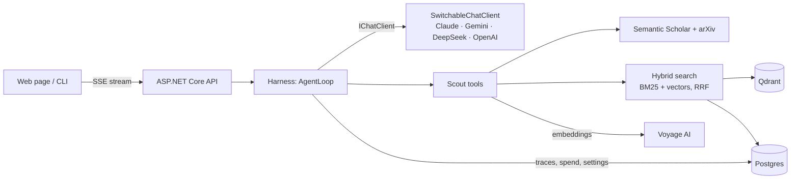

# Research Scout

A C#/.NET research assistant that runs on **my own agent harness**: no agent framework, and no `FunctionInvokingChatClient`. It does two jobs:

1. **Paper Q&A with page citations.** It downloads a paper, splits it into page-tagged chunks, and answers questions with tags like `[arxiv:2005.11401 p.4]` that link to the exact PDF page.
2. **Professor matching.** It finds researchers at a university, scores how well their last 3 years of papers fit my interests (AI for software engineering, RAG, code intelligence), and drafts an outreach email that only cites papers they really wrote, after I approve it.

**Live demo:** _add the Render URL here after deploy_ · The first request after 15 quiet minutes takes about a minute (free hosting).

> Why I built it: I'm applying to funded thesis-based MSc programs. Reading professor pages and papers by hand was slow, and generic chatbots invent citations. This tool's answers can be checked page by page.

---

## Architecture



| Project | What it holds |
|---|---|
| `ResearchScout.Harness` | The agent loop, tool registry, approval gate, budgets, retries, observer events. Knows nothing about papers or providers; its only package is `Microsoft.Extensions.AI.Abstractions` (checked by a test). |
| `ResearchScout.Llm` | Provider plumbing: Claude, Gemini, DeepSeek and OpenAI behind one `IChatClient`, switchable at runtime; model price list; error classifier. |
| `ResearchScout.Infra` | EF Core + Postgres: traces, saved model choice, daily spend, API cache, papers, chunks, email drafts. |
| `ResearchScout.Papers` | Semantic Scholar client, PDF download, PdfPig chunker, Voyage embeddings, Qdrant, BM25, hybrid search, ingest. |
| `ResearchScout.Scout` | The six tools, fit scorer, system prompt, eval scoring, and `ScoutServices` (shared setup). |
| `ResearchScout.Api` | Minimal API: `POST /ask` (SSE), approvals, admin, traces, and the web page. |
| `ResearchScout.Cli` | `scout ask / ingest / search / chat / models / runs / trace / db migrate` |
| `ResearchScout.Eval` | Citation accuracy, retrieval recall@5, refusal check, professor ranking. |

## The harness

The loop is under 300 lines, and it decides everything about a run:

- **Loop:** ask the model → run the tools it asked for, in order → send the results back → repeat. It stops on a final answer, after 12 steps, at the run budget, at the daily cap, or on a model error that retries can't fix.
- **Tools are declarations only.** The model gets name + description + JSON schema (`AIFunctionDeclaration`), so nothing else can run a tool behind the harness's back.
- **Approval gate:** tools marked `NeedsApproval` (here `draft_email`) pause the run until a human answers: a console prompt in the CLI, or approve/reject buttons on the web page (it times out after 5 minutes and counts as a rejection). With no gate set up, the default is to reject.
- **Errors never crash a run.** An unknown tool, bad arguments, an exception or a "not found" all go back to the model as `Error: ...`. Stack traces are never sent.
- **Retries:** exponential backoff with jitter (≈1s, ≈2s, 3 tries), only for temporary failures. An error classifier knows each SDK's exception types. A streamed answer is never retried once text has been shown, so text never appears twice.
- **Budgets:** per run (default $0.05 / 200k tokens) and a **daily cap** for the public demo ($0.50). Daily spend is one atomic Postgres upsert, so parallel runs can't lose updates.
- **Tracing:** every step (model, tokens, cost, time, tries, each tool's input/output and approval) is saved to Postgres. Use `scout trace <id>` or `GET /runs/{id}/trace`.
- **Provider switching:** the admin picks the model on the web page; it applies from the next run. One run stays on one model, because Gemini's thought signatures and Claude's thinking blocks don't carry over to other providers. DeepSeek goes through the Anthropic SDK on DeepSeek's Anthropic-format URL, because Microsoft's OpenAI adapter drops `reasoning_content` and thinking-mode tool calls then fail.

## Retrieval and citations

- **Chunking:** about 375 words per chunk with 40 words of overlap. **Chunks never cross a page boundary**, so every chunk has exactly one page number and citations are exact.
- **Hybrid search:** vector search (Voyage `voyage-4-lite`, query/document input types) plus BM25 for exact terms like `MRR@10`, merged with reciprocal rank fusion: score = Σ 1/(60 + rank).
- **Ingest order:** vectors go to Qdrant before the rows go to Postgres, so a failure can't leave a paper marked "ingested" without vectors. Ingesting the same paper twice does nothing. The BM25 index is rebuilt from Postgres at startup, because the free host's disk is wiped.

## Professor fit score

For each paper from the last 3 years:
`similarity` = cosine(profile, "title. abstract"), and `recency weight` = 1 − 0.15 × age in years (1.0, 0.85, 0.70).
**Score** = the average of `similarity × weight` over the author's best 5 papers, × 100.
All papers are embedded in one batched call. `draft_email` checks every cited paper against the professor's actual Semantic Scholar list before saving, and never sends anything.

## Eval

```bash
dotnet run --project src/ResearchScout.Eval -- ingest      # 5 papers from eval/papers.json
dotnet run --project src/ResearchScout.Eval -- retrieval   # recall@5, no LLM, free
dotnet run --project src/ResearchScout.Eval -- citations   # runs the agent on 15 questions (a few cents)
dotnet run --project src/ResearchScout.Eval -- ranking     # needs names in eval/professors.json
```

- **Citation accuracy** = correct citations ÷ all citations. A citation is correct if the cited page contains every evidence phrase for that question.
- **Invented citations** = tags pointing to a page that doesn't exist in the ingested papers.
- **Refusal** = the unanswerable question gets "Not found in the ingested papers".
- Results are saved to `eval/results/`. The starter questions use facts from well-known papers. Check the evidence phrases against the PDFs before quoting the numbers.

| Metric | Result |
|---|---|
| Retrieval recall@5 | _run `eval retrieval`_ |
| Citation accuracy | _run `eval citations`_ |
| Questions with ≥1 correct citation | _run `eval citations`_ |
| Professor ranking: known good fits in top 5 | _fill `eval/professors.json`, run `eval ranking`_ |

## Run locally

Needs the .NET 10 SDK and Docker.

```bash
cp .env.example .env            # add at least one LLM key + VOYAGE_API_KEY
docker compose up -d            # Postgres + Qdrant
cd src/ResearchScout.Cli
dotnet run -- db migrate
dotnet run -- ingest arXiv:2005.11401
dotnet run -- ask "How does the RAG paper combine retrieval and generation?"
dotnet run -- ask "Which professors at Memorial University of Newfoundland work on LLMs for code?"
dotnet run -- runs              # then: dotnet run -- trace <id>
```

Web page: `dotnet run --project src/ResearchScout.Api`, then open the URL it prints.

Tests: `dotnet test` (unit tests always run). Set `TEST_DATABASE_URL` to also run the Postgres and API tests, and `TEST_QDRANT_URL` for the Qdrant test. CI runs everything against real Postgres and Qdrant services.

## Deploy (free)

1. **Supabase:** create a project → Connect → copy the **Session pooler** URL (IPv4) → `DATABASE_URL`.
2. **Qdrant Cloud:** create a free cluster → copy its URL and an API key → `QDRANT_URL`, `QDRANT_API_KEY`.
3. **Voyage AI:** create a key → `VOYAGE_API_KEY`. Also have at least one LLM key.
4. **Render:** New → Blueprint → this repo (uses `render.yaml`). Fill in the secrets it asks for. Copy the generated `ADMIN_PASSWORD` from the dashboard.
5. **Deploy hook:** Render service → Settings → Deploy Hook → copy the URL → GitHub repo → Settings → Secrets → Actions → `RENDER_DEPLOY_HOOK_URL`. From then on, every push to `main` that passes tests and the Docker build deploys automatically.
6. Load the demo papers once against the live database: run `eval ingest` locally with the production `DATABASE_URL`, `QDRANT_URL` and `QDRANT_API_KEY` in `.env`.

Tables are created automatically on startup.

## Limits and costs

- Semantic Scholar has affiliations for only some authors. If `find_professors` finds nobody, give it names from the faculty page.
- Only open-access papers (arXiv or a free PDF link) can be read.
- Demo spend is capped per day. Visitors get 10 questions per hour per IP, and at most 3 runs happen at once.
