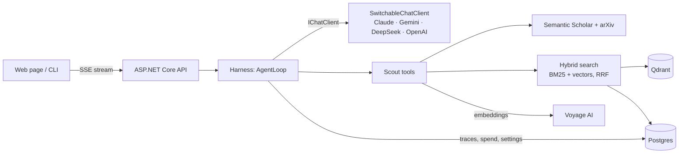
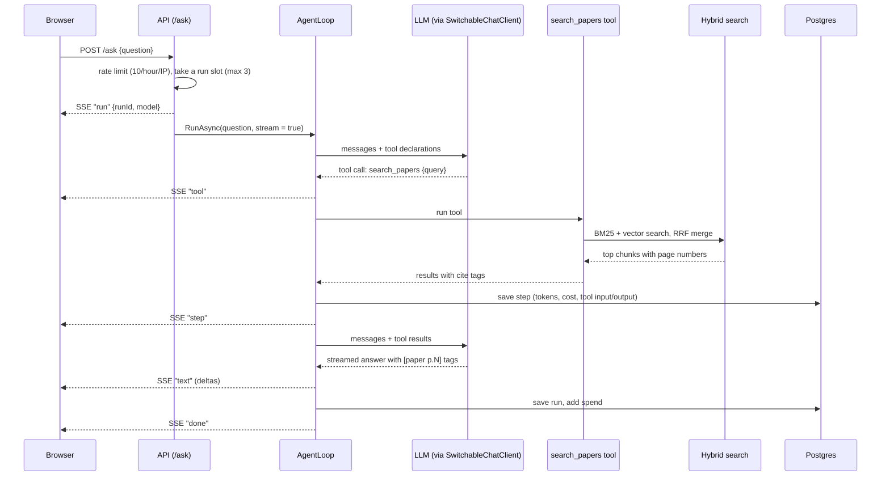

# Architecture

## The big picture

## Projects

The solution is `ResearchScout.slnx`. Dependencies point one way: the harness knows nothing about papers or providers.

| Project | What it holds | Depends on |
| --- | --- | --- |
| `ResearchScout.Harness` | Agent loop, tool registry, approval gate, budgets, retries, observer events | Only `Microsoft.Extensions.AI.Abstractions` (a test enforces this) |
| `ResearchScout.Llm` | Provider clients behind one `IChatClient`, runtime model switching, price list, error classifier | Harness |
| `ResearchScout.Infra` | EF Core + Postgres: traces, saved model choice, daily spend, API cache, papers, chunks, email drafts | Harness, Llm |
| `ResearchScout.Papers` | Semantic Scholar client, PDF download, PdfPig chunker, Voyage embeddings, Qdrant, BM25, hybrid search, ingest | Harness, Infra |
| `ResearchScout.Scout` | The six tools, fit scorer, system prompt, eval scoring, `ScoutServices` (shared setup) | All of the above |
| `ResearchScout.Api` | Minimal API: `/ask` (SSE), approvals, admin, traces, and the web page in `wwwroot` | Scout |
| `ResearchScout.Cli` | `scout ask / ingest / search / chat / models / runs / trace / db migrate` | Scout |
| `ResearchScout.Eval` | Citation accuracy, retrieval recall@5, refusal check, professor ranking | Scout |

`ScoutServices` is the composition root. The API, the CLI and the eval all build the same objects through it, so they behave the same way.

## The life of one question

What happens when a visitor types "Which retriever does the RAG paper use?" on the web page:

Step by step:

1. **Admission.** The API checks the per-visitor rate limit and takes one of the run slots (`MAX_CONCURRENT_RUNS`, default 3). If none is free it answers 503 "The demo is busy".
2. **Start.** It creates a run id, picks the current model and opens a server-sent events stream.
3. **Loop.** The harness asks the model. The model either answers or asks for tools. The harness runs the tools, sends back the results, and repeats until there's a final answer or a limit is hit.
4. **Stream.** Each step, tool call and text piece is sent to the browser as it happens.
5. **Record.** Every step (model, tokens, cost, time, tries, each tool's input and output) is saved to Postgres. Today's spend is added in one atomic update.
6. **Finish.** The browser gets a `done` event with the status, the final text and a link to the trace.

If the visitor closes the tab, the request is cancelled and the run stops.

## Where data lives

| Data | Store | Why there |
| --- | --- | --- |
| Paper metadata, chunk text with page numbers | Postgres (`papers`, `chunks`) | Source of truth; also used to rebuild the BM25 index at startup |
| Chunk vectors | Qdrant (`chunks` collection) | Fast vector search |
| BM25 keyword index | In memory, rebuilt from Postgres at startup | The free host's disk is wiped on every restart |
| Runs, steps, spend, model choice, API cache, email drafts | Postgres | Survives restarts; queryable |

## Design choices

| Choice | Why |
| --- | --- |
| Own harness instead of an agent framework | Full control of approvals, budgets, retries and tracing, and nothing runs a tool behind the harness's back |
| One run stays on one model | Gemini's thought signatures and Claude's thinking blocks don't carry over to other providers |
| DeepSeek through the Anthropic SDK | Microsoft's OpenAI adapter drops DeepSeek's `reasoning_content`, which breaks tool calls in thinking mode |
| Chunks never cross a page | Every chunk has exactly one page number, so citations are exact |
| Vectors are written before rows | A failure can't leave a paper marked "ingested" without vectors |
| BM25 alongside vectors | Exact terms like `MRR@10` or a model name are found even when meaning-based search blurs them |
