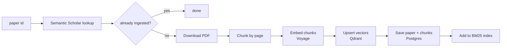

# Papers and retrieval

This covers how a paper gets into Research Scout, and how a question finds the right page.

## Ingest pipeline

`PaperIngestor.IngestAsync(paperId)` in `src/ResearchScout.Papers`:

1. **Look up the paper** on Semantic Scholar. Accepted ids: `arXiv:2106.15928`, `DOI:10.1145/...`, or a Semantic Scholar paper id. Responses are cached in `api_cache` for 7 days.
2. **Skip if already ingested.** Ingesting the same paper twice does nothing.
3. **Download the PDF.**
   - If the paper is on arXiv, it uses `https://arxiv.org/pdf/<id>`.
   - Otherwise it uses Semantic Scholar's open-access link.
   - arXiv comes first because publisher links often block scripts (HTTP 403) or fail TLS.
   - Limit: 30 MB. The file must start with `%PDF`, so a paywall page is rejected.
4. **Chunk** with PdfPig (see below).
5. **Embed** the chunks with Voyage AI.
6. **Write vectors to Qdrant first,** then the paper and chunk rows to Postgres. So a failure can't leave a paper marked "ingested" without vectors.
7. **Add the chunks to the BM25 index** in memory.

Only open-access papers can be read: arXiv, or a free PDF link.

## Chunking

`PdfChunker`:

| Setting | Value | Why |
| --- | --- | --- |
| Chunk size | about 375 words | About 500 tokens (1 token ≈ 0.75 English words) |
| Overlap | 40 words | A sentence split across two chunks still appears whole in one |
| Minimum | 60 words | A shorter leftover is joined to the previous chunk on the same page |
| Page rule | **A chunk never crosses a page boundary** | Every chunk has exactly one page number, so citations are exact |

## Embeddings

- Model: Voyage `voyage-4-lite`, 1024 dimensions (configurable in `appsettings.json` under `Embeddings`).
- Voyage embeds questions and documents differently, so the code passes `input_type = query` or `document`. This improves retrieval.
- Requests are batched (up to 128 texts), never one request per text.

### Voyage free tier

Voyage accounts **without a payment method** are limited to **3 requests and 10,000 tokens per minute**. With `VOYAGE_FREE_TIER=true`:

| Rule | Value |
| --- | --- |
| Tokens per request | at most about 3,000 (estimated) |
| Requests per rolling minute | at most 3 |
| Tokens per rolling minute | at most about 7,000 (a margin under 10,000, because the count is an estimate) |
| Token estimate | 1 token per 3 characters (plain English is nearer 4; code and math nearer 2–3) |
| On HTTP 429 | wait about 30–65 seconds and retry, up to 5 tries |

Loading 5 papers takes about 15 minutes in this mode. Adding a payment method on Voyage removes the limit. The first 200M tokens are still free.

## Hybrid search

`HybridSearch.SearchAsync(query, k)`:

1. **Vector search** in Qdrant: embed the question (as a query), get the nearest chunks.
2. **Keyword search** with BM25 over chunk text. This catches exact terms like `MRR@10` or a model name that meaning-based search can blur.
3. **Merge with reciprocal rank fusion (RRF):**

   score(chunk) = Σ over the two result lists of 1 / (60 + rank)

   rank starts at 1. A chunk found by only one list gets only that list's part. The constant 60 is standard; it stops the top rank from dominating.
4. Return the top chunks with paper id, title, page, text and a `cite` tag.

The BM25 index is rebuilt from the `chunks` table at startup, because the free host's disk is wiped on every restart.

## Citations

- `search_papers` returns a `cite` tag for each result, like `[arxiv:2005.11401 p.3]`.
- The system prompt (`ScoutPrompts`) tells the model to put a tag after **every claim** that uses a source, and to say "Not found in the ingested papers" instead of guessing.
- The web page turns each arXiv tag into a link to that page of the PDF (`https://arxiv.org/pdf/<id>#page=<n>`).
- Paper ids: `arxiv:<id>` when the paper is on arXiv, otherwise `s2:<Semantic Scholar id>`.

The [Evaluation](12-evaluation.md) checks that each cited page really contains the answer.
