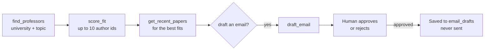

# Professor matching

Research Scout can find researchers at a university, rank them by how well their recent work fits a research profile, and draft an outreach email that a human approves.

## The flow

A typical run for "Which professors at Memorial University work on LLMs for code?":

The model decides which tools to call and in what order. The tools are described in [Tools reference](06-tools-reference.md).

## Finding researchers

`find_professors` searches Semantic Scholar for authors who publish on the topic and whose affiliation matches the university.

**Important limits:**

- Semantic Scholar has affiliations for **only some authors**. An empty result does not mean nobody at that university works on the topic.
- The best fix is to give it **names from the faculty page** (the `names` input). Names are looked up directly and matched exactly.
- It works **without an API key**, using Semantic Scholar's shared free pool. Requests are spaced 1.1 seconds apart and 429s are retried with longer waits, so a search can take a minute or two when the pool is busy. See [Troubleshooting](13-troubleshooting.md#semantic-scholar-429-too-many-requests).

## The fit score

`FitScorer` compares each author's recent papers with the research profile in [`profile.md`](../profile.md).

For each paper from the **last 3 years**:

| Quantity | How it's worked out |
| --- | --- |
| similarity | cosine similarity between the profile's embedding and the embedding of "title. abstract" (0 to 1) |
| recency weight | 1 − 0.15 × age in years: 1.0 this year, 0.85 last year, 0.70 two years ago |
| weighted | similarity × recency weight |

**Score** = the average of "weighted" over the author's **best 5 papers**, × 100, rounded (0–100).

Using the best 5 papers (not all of them) means one strong line of work counts, even for very prolific authors.

All papers of all authors are embedded in **one batched request**. Each score comes back with the 3 best-matching papers as evidence.

### Worked example

An author has these 3 papers from the last 3 years:

| Paper | similarity | age | recency weight | weighted |
| --- | --- | --- | --- | --- |
| A | 0.62 | 0 years | 1.00 | 0.620 |
| B | 0.55 | 1 year | 0.85 | 0.468 |
| C | 0.40 | 2 years | 0.70 | 0.280 |

They have fewer than 5 papers, so all 3 count. Average weighted = (0.620 + 0.468 + 0.280) ÷ 3 = 0.456. Score = 0.456 × 100 ≈ **46**.

## The research profile

[`profile.md`](../profile.md) is plain text. Edit it freely; short bullet points of topics work best. If the file is missing, a built-in default is used (RAG for code, code intelligence, LLMs for software engineering, event-driven systems). The path can be changed with the `ProfilePath` setting.

## Email drafts

`draft_email` **needs approval** and **never sends anything**. Before a draft is saved:

- `authorId`, `professorName`, `subject` and `body` must all be filled in.
- The body must be **under 200 words**.
- It must cite **1 or 2** of the professor's papers in `citedPaperIds`.
- **Every cited paper is checked** against the professor's actual Semantic Scholar paper list. A paper they didn't write is rejected, so the email can't invent a citation.

Approved drafts are stored in the `email_drafts` table.
