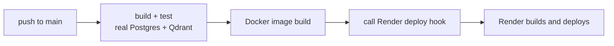

# Deployment

Everything runs on free tiers. Total hosting cost: $0. LLM calls cost a few cents, and the live demo is capped at $0.50 a day.

| Part | Service | Free tier |
| --- | --- | --- |
| Web app (Docker) | Render | Sleeps after 15 idle minutes; first request then takes about a minute |
| Postgres | Supabase | 500 MB; pauses after a week with no activity |
| Vectors | Qdrant Cloud | 1 GB cluster |
| Embeddings | Voyage AI | First 200M tokens free; low rate limit without a payment method |
| LLM | DeepSeek, Gemini, Claude or OpenAI | Pay per use (DeepSeek and Claude need credit; Gemini has a free tier) |
| CI/CD | GitHub Actions | Free for public repos |

## 1. Supabase (Postgres)

1. Create a project at supabase.com. Save the database password.
2. Click **Connect** in the top bar → choose **Session pooler**. Direct link: `https://supabase.com/dashboard/project/_?showConnect=true&method=session`.
3. Copy the string and put your password in place of `[YOUR-PASSWORD]`. This is `DATABASE_URL`.

Use the **Session pooler**, not the direct connection. Render's free tier can't reach the direct (IPv6-only) address. A correct string has `pooler.supabase.com:5432` and a username like `postgres.<project-id>`.

Tables are created automatically on first start.

## 2. Qdrant Cloud (vectors)

1. Create a **Free** cluster at cloud.qdrant.io.
2. Copy the cluster URL (`https://xxxx.cloud.qdrant.io:6333`) → `QDRANT_URL`.
3. Create an API key → `QDRANT_API_KEY` (shown once).

## 3. Keys

- **Voyage:** dash.voyageai.com → API keys → `VOYAGE_API_KEY`. Without a payment method, set `VOYAGE_FREE_TIER=true`.
- **At least one LLM key.** DeepSeek keys start with `sk-` and need a small balance.
- **Semantic Scholar (optional):** works without a key on the shared free pool (slower when busy). A free key from semanticscholar.org/product/api → `SEMANTIC_SCHOLAR_API_KEY` gives your own limit.

## 4. Load the demo papers

The live site can only answer about papers in the database. Load the 5 eval papers once from your own computer, with the production values in `.env`:

```bash
dotnet run --project src/ResearchScout.Eval -- ingest
```

On the Voyage free tier this takes about 15 minutes. Running it again is safe; it skips papers that are already in.

## 5. Render

1. render.com → sign in with GitHub → **New → Blueprint** → pick this repo. Render reads `render.yaml`: one free Docker web service with a `/health` check.
2. Fill in the secrets it asks for: `DATABASE_URL`, `QDRANT_URL`, `QDRANT_API_KEY`, `VOYAGE_API_KEY`, your LLM key(s), and optionally `SEMANTIC_SCHOLAR_API_KEY` and `ALLOWED_ORIGINS`.
3. `ADMIN_PASSWORD` is generated by Render. `DAILY_SPEND_CAP_USD` (0.50), `MAX_CONCURRENT_RUNS` (3) and `VOYAGE_FREE_TIER` (true) come from the blueprint.
4. Click **Apply**. The first Docker build takes about 5–10 minutes.
5. Copy `ADMIN_PASSWORD` from the service's **Environment** tab.

`autoDeploy` is off in `render.yaml`. Deploys are triggered by GitHub Actions after the tests pass (next step).

## 6. Auto-deploy from GitHub

1. Render service → **Settings → Deploy Hook** → copy the URL.
2. GitHub repo → **Settings → Secrets and variables → Actions** → new secret `RENDER_DEPLOY_HOOK_URL`.

From then on, every push to `main`:



If the secret isn't set, the deploy step prints "secret not set; skipping deploy" and passes.

## 7. Check it

- `https://<your-service>.onrender.com/health` returns `{"status":"ok"}`.
- Ask a paper question: the answer streams in with `[paper p.N]` citations.
- Ask something the papers can't answer: it says "Not found".
- The "Today's demo budget" bar goes up after each question.
- The admin panel accepts `ADMIN_PASSWORD` and can switch models.

## Production settings

| Setting | Value |
| --- | --- |
| HTTPS | Enforced (HSTS outside development) |
| CORS | Only origins in `ALLOWED_ORIGINS` |
| Rate limit | 10 questions per hour per IP on `/ask`; 10 per minute on `/admin` |
| Concurrency | 3 runs at once |
| Spend | $0.05 per run, $0.50 per day |
| Secrets | Never logged |
| Container | Multi-stage build, .NET 10 runtime image, non-root user, port 8080 (or Render's `PORT`) |
